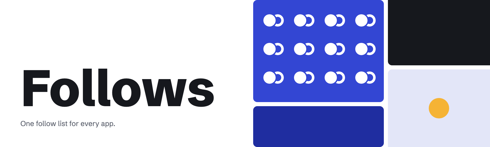

# Follows brand



Follows is one follow list for every app. A person follows an account once, the follow is written to a Lattice chain, and every app that reads Follows sees it: Stoa, Murmur and whatever comes next. The brand is about that one link between two accounts. The mark is a solid disc, you, leaning into a ring, the account you follow. Everything else stays quiet so that the link reads.

These are Follows' brand guidelines, with the files to use:

- [Logo](docs/logo.md): the suite, construction, clear space, minimum sizes, do's and don'ts.
- [Color](docs/color.md): every value in HEX, RGB and CMYK, with contrast and accessibility rules.
- [Typography](docs/typography.md): the faces, weights, scale, case and web-safe fallbacks.

## Principles

- **One link, one color.** Indigo (`accent`) is the brand and the action: the Follow button, links, focus and the mark's disc. Nothing else on a page is Indigo. In dark theme it becomes Periwinkle, never Indigo on a dark ground.
- **White ground, ink text.** Pages are `bg` with `ink` text and `muted` for what matters less. Rows separate by a 1px `line`. No shadows, no gradients.
- **Marigold is rare.** `highlight` appears only as a small fill with `on-highlight` text, for "Follows you" and a new follower. If more than one Marigold thing is on screen, one of them is wrong.
- **Type does the hierarchy.** Schibsted Grotesk at 700 for what you read first and 400 for the rest; JetBrains Mono for account tails, addresses and CIDs, which people compare character by character.
- **Accounts, not profiles.** Follows stores account to account. A handle is a name an account shows today, so the UI shows a handle where one exists and the account's tail (`…ada4`) where none does. Never invent a display name or a photo.
- **Self-hosted.** Fonts and marks ship with the page. No font host or CDN learns who reads Follows.

## Voice

Plain, short and exact about what happens. Say "you" to the reader. Name the account or handle involved.

- "One follow list for every app."
- "Follow someone once and every app that reads Follows knows it."
- "No account shows @ada now, so there is no one to follow."
- "You can't follow yourself."
- "No coins needed: this device's work pays each fee."

Rules:
- Sentence case for headings, buttons and labels ("Recently viewed", "Show a handle"). Title case only for proper names: Follows, Lattice, Selfhold, Moniker, Stoa.
- Buttons say the action: **Follow**, **Following**, **Unfollow**, **Connect Selfhold**.
- Handles are lowercase with their `@`: `@ada`. Account tails start with an ellipsis and stay lowercase: `…ada4`.
- No exclamation marks, emoji or hype words ("social graph revolution", "web3"). Counts are plain numbers: "12 followers", "1 follower".
- Errors say what happened and what to do, without apology: "The sponsor couldn't pay this fee. Try again in a few minutes."

## Iconography

Follows has no icon set. The mark is the only drawn symbol; controls are words. Where a glyph is needed, use a typographic one from Schibsted Grotesk (`·`, `…`, `→`) in the surrounding text color. Avatars are a disc in `avatar` with the handle's first letter, or the tail's last two characters, in `avatar-ink`.

## Files

| Path | What |
|---|---|
| [`logos/`](logos) | The mark, horizontal and stacked lockups and the wordmark: two-tone, reversed, one-color ink and white, plus `follows-lockup-themed.svg` for inlining in a themed page. Outlined SVG, no font needed. |
| [`favicons/`](favicons) | `favicon.svg`, 16 and 32px PNGs, the 180px Apple touch icon, the 512px app icon. |
| [`fonts/`](fonts) | Schibsted Grotesk (variable, 400–900, latin and latin-ext) and JetBrains Mono 400, WOFF2, with their SIL Open Font Licenses. |
| [`tokens.json`](tokens.json) | Colors for both themes, type styles, spacing, radii and logo minimums. |
| [`tokens.css`](tokens.css) | The same as custom properties, `@font-face` rules and a class per type style. |
| [`source/`](source) | What draws the marks and builds `tokens.css`. |

## Rebuilding

The marks are drawn by a script, so a change to the geometry or a color is made there, never by editing an SVG.

```sh
pip install fonttools brotli
python3 source/marks.py              # logos/ and favicons/*.svg, the wordmark outlined from fonts/
sh source/png.sh "$PWD"              # favicons/*.png, rendered in headless Chrome
python3 source/tokens.py > tokens.css
```

The code is under the MIT License. The fonts are under the SIL Open Font License 1.1, in `fonts/`.
