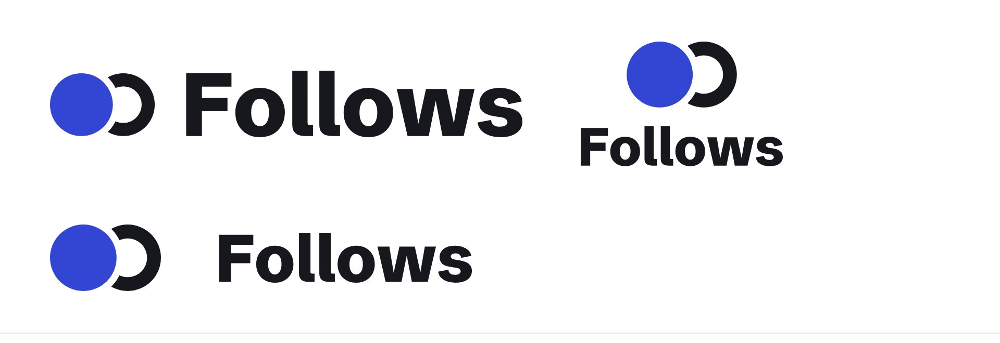
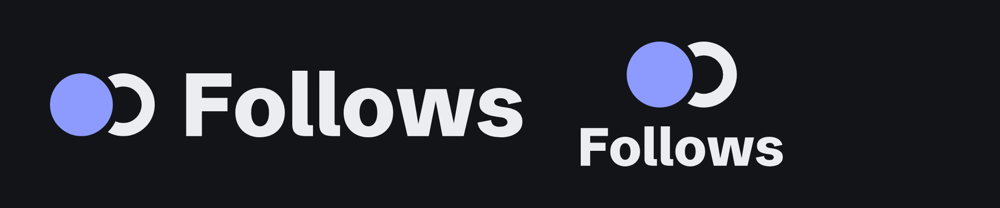
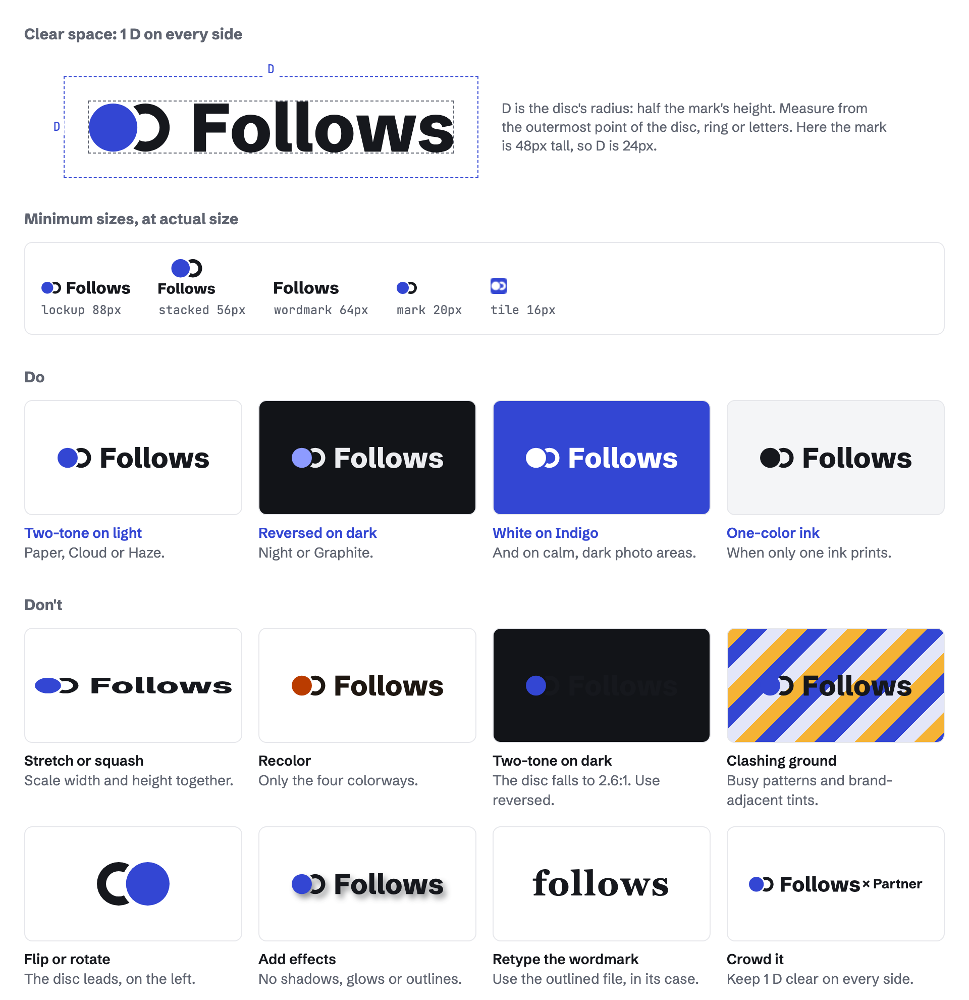
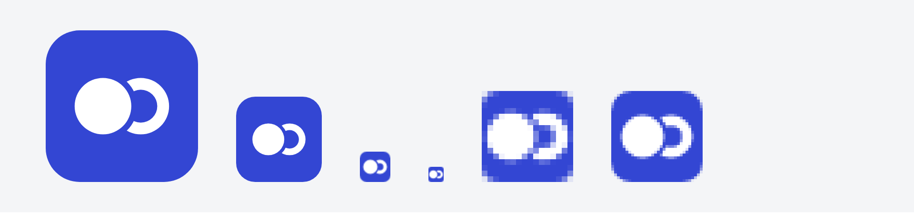

# Logo

## The suite





| Version | File | Use it for |
|---|---|---|
| Primary lockup | [`follows-lockup.svg`](../logos/follows-lockup.svg) | The default everywhere there is room: site headers, docs, decks, the README of an app built on Follows. |
| Stacked lockup | [`follows-lockup-stacked.svg`](../logos/follows-lockup-stacked.svg) | Square or tall spaces: a splash screen, a sticker, a profile square. |
| Mark | [`follows-mark.svg`](../logos/follows-mark.svg) | Where the name is already present or space is tight: next to the word "Follows" in running UI, social avatars, the corner of a slide. |
| Wordmark | [`follows-wordmark.svg`](../logos/follows-wordmark.svg) | Text-only placements where the mark would be noise: a footer credit, "Works with Follows" lines. |
| App icon and favicons | [`app-icon.svg`](../favicons/app-icon.svg), [`favicon.svg`](../favicons/favicon.svg), PNGs | Browser tabs, home screens, app stores. The tile is the only place the mark appears on Indigo by default. |

Each comes in four colorways:

| Colorway | Disc | Ring and wordmark | Ground |
|---|---|---|---|
| Two-tone (primary) | Indigo `#3346D3` | Ink `#16181D` | Paper, Cloud, Haze, or any light ground at least as light as Mist |
| Reversed | Periwinkle `#8D9BFF` | Fog `#ECEDF0` | Night, Graphite, or any dark ground at least as dark as Steel |
| One-color ink | Ink | Ink | Light grounds, when only one ink is available (one-color print, embossing, a fax) |
| White | Paper | Paper | Indigo, photographs (on a darkened area), any ground where the two-tone fails |

For a page that switches between light and dark, inline [`follows-lockup-themed.svg`](../logos/follows-lockup-themed.svg): its disc takes the page's `--accent` and its ring and wordmark the page's `--ink`, so it follows the theme. On its own it draws the two-tone lockup.

There is also an all-Indigo mark ([`follows-mark-indigo.svg`](../logos/follows-mark-indigo.svg)) for UI where the mark sits next to a live Indigo control and two-tone would compete.

## Construction

The mark is drawn on a 40 × 24 grid. Its unit is **D**, the disc's radius: 12 units, half the mark's height.

- **Disc:** a circle of radius D, centered at (D, D).
- **Ring:** a circle of radius D centered 16 units (4/3 D) to the right, stroked 5 units wide inward. At 32px and below the ring is drawn 6 units wide so it holds a pixel.
- **Gap:** the ring is cut 2.5 units clear of the disc all round, so the two never touch.
- **Lockup:** the wordmark's cap height equals the mark's height; the mark sits on the baseline; the gap between mark and wordmark is 1 D.
- **Stacked:** the mark at 1.75× the cap height, centered, 1 D above the wordmark's cap line.
- **Wordmark:** "Follows" in Schibsted Grotesk ExtraBold (800), tracked −1%, outlined. Never retype it in a live font.

## Clear space, minimum sizes, do's and don'ts



## Clear space

Keep **1 D** clear on every side of any logo: half the mark's height, measured from the outermost point of the disc, ring or letters. No text, edge, image or other mark enters that space. The favicon and app icon carry their clear space inside the tile.

| Placed at | 1 D is |
|---|---|
| Lockup, mark 24px tall (a site header) | 12px |
| Lockup, mark 16px tall | 8px |
| Stacked, 160px wide | 15px |

## Minimum sizes

| Version | Screen | Print |
|---|---|---|
| Horizontal lockup | 88px wide (mark 12px tall) | 25mm wide |
| Stacked lockup | 56px wide | 16mm wide |
| Wordmark | 64px wide | 18mm wide |
| Mark | 20px wide | 6mm wide |
| Favicon tile | 16px | n/a |

Below the mark's minimum, use the favicon tile, which is drawn for 16 and 32px.



```html
<link rel="icon" href="/favicon.svg" type="image/svg+xml">
<link rel="icon" href="/favicon-32.png" sizes="32x32" type="image/png">
<link rel="icon" href="/favicon-16.png" sizes="16x16" type="image/png">
<link rel="apple-touch-icon" href="/apple-touch-icon.png">
```

## Do

- Use the files as supplied, scaled proportionally.
- Use two-tone on light grounds and reversed on dark ones.
- Use the white version on Indigo and on photographs, over a calm, darkened area.
- Use the one-color ink version when only one ink is available.
- Keep 1 D of clear space and respect the minimum sizes.
- Point the mark the way it is drawn: disc on the left, leaning into the ring. It reads as "you follow".

## Don't

- **Stretch or squash it.** Width and height scale together.
- **Recolor it** outside the four colorways: no Marigold mark, no gradient, no Indigo ring with an Ink disc, no tints.
- **Place it on a clashing ground:** two-tone on Night (the Indigo disc falls to 2.6:1), reversed on white, any version on a busy photo or on a ground within a few shades of its own colors.
- **Flip or rotate it.** Mirrored, the ring follows the disc.
- **Close the gap**, fill the ring, or redraw the disc and ring as separate pieces with different spacing.
- **Add effects:** shadows, glows, outlines, bevels, animation of its parts.
- **Rebuild the wordmark** in another font, weight or case ("follows", "FOLLOWS"), or change the space between mark and wordmark.
- **Put the mark inside another shape** other than the app icon's rounded tile.
